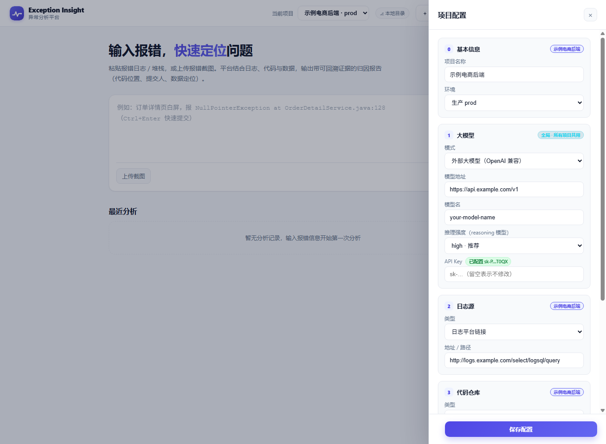
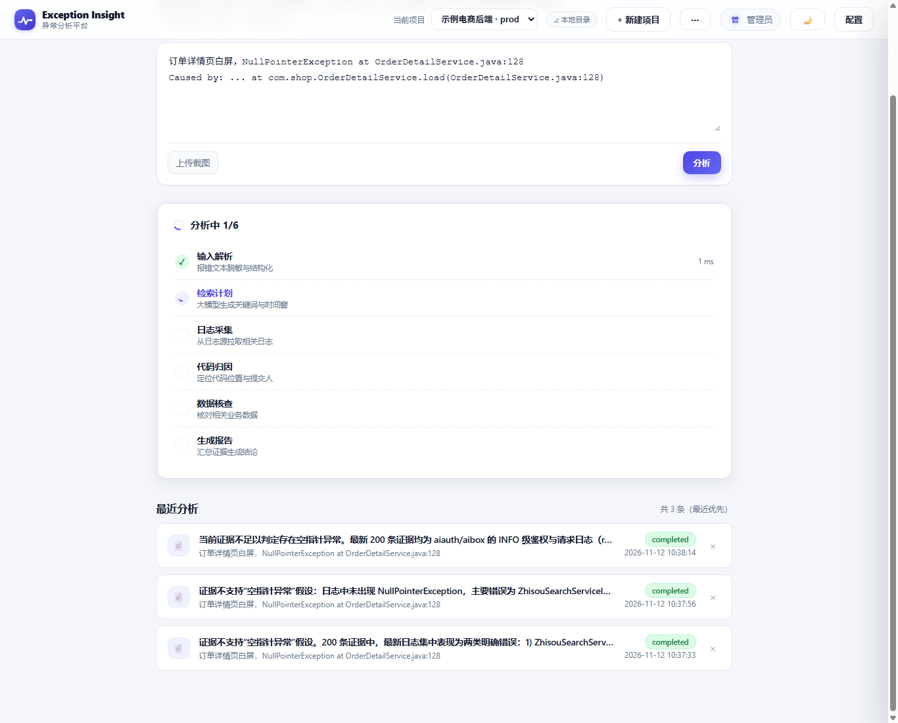

# Exception Insight · 异常分析平台

> 粘贴一段报错，自动从日志平台捞出相关日志，定位到代码行与最近提交人，输出一份**带可回溯证据的归因报告**。


> 左：粘贴报错一键分析　中：配置抽屉（模型 / 日志源 / 代码仓库均可配置）　右：深色模式

| 配置抽屉 | 深色模式 |
| --- | --- |
|  |  |

## 它解决什么

线上排障现在靠「人找人」：客诉截图发群里 → 猜是哪个服务 → 登日志平台手搜 → 翻仓库找 `file:line` → 手动 blame → 查库。一次定位常跨 3 个系统、问 2 个人，结论还只留在群聊里。

| | 传统排查 | Exception Insight |
| --- | --- | --- |
| 入口 | 群里问人 | 粘贴报错文本或上传截图 |
| 找日志 | 手登平台搜关键词 | 按时间窗 + 关键词自动拉取，ERROR/WARN 优先 |
| 定位代码 | 翻仓库、手动 blame | 解析堆栈 → GitLab / GitHub 提交追溯 |
| 结论 | 口头结论，无留痕 | 一份报告：结论 / 证据链 / 影响面 / 建议 / 未验证项 |

平台**只给排查建议**，不自动修复、不改代码、不改数据。

## 30 秒跑起来

**方式 A：直接用发布包**（不想装依赖时最省事）

从 [GitHub Releases](https://github.com/1576584678/exception-agent/releases) 下载 `exception-insight.zip`，解压后：

- Windows：双击 `start.bat`
- Linux / macOS：`chmod +x start.sh && ./start.sh`

浏览器打开 `http://localhost:3000`，用 `1001 / dev123` 登录。首次启动自动生成 `.env` 和随机 `JWT_SECRET`，包内不含任何密钥。

**方式 B：源码运行**（Node.js 18+）

```bash
git clone https://github.com/1576584678/exception-agent.git
cd exception-agent
npm ci && npm run build
cp .env.example .env
# 把 .env 里的 JWT_SECRET 换成随机值（至少 16 字符）
npm start
```

打开页面后，右上角「配置」里填一次：大模型（全局，所有项目共用）、日志源和代码仓库（每个项目独立）。之后每次只需输入报错信息即可分析。

## 界面

| 配置（全局模型 + 按项目日志源/仓库） | 分析进度（异步，六阶段实时反馈） |
| --- | --- |
|  |  |

深色模式在顶栏 🌙/☀️ 切换；报告证据链默认收起、分页展开；历史记录与项目都能删除。

## 能接什么

| 能力 | 支持 | 说明 |
| --- | --- | --- |
| 大模型 | OpenAI 兼容网关 | 任意 `host:port` / `/v1` / 完整 `/chat/completions` 地址，自动补全路径；支持 `reasoning_effort`；不配则用本地 stub |
| 日志源 | VictoriaLogs / Elasticsearch / Loki / 通用 HTTP | 按地址自动识别，无需手选类型；关键词 0 命中自动兜底 ERROR/WARN |
| 代码仓库 | GitLab / GitHub | 堆栈解析 `file:line`；GitLab 走 blame API，GitHub 用「该文件最近一次提交」近似并如实标注边界 |
| 多项目 | 支持 | 全局模型一份，项目配置多份；顶栏切换、可改名/改分支/删除 |
| 业务数据 | 模板化只读（当前为 stub） | 白名单 + 列黑名单校验；未接真实数据源时该阶段直接跳过，不产出假数据 |

密钥只写服务端 `.env`、不落库、只回传掩码；凭证、日志、代码全程只读。

## 边界与当前状态（不夸大）

这是一个**自用阶段的 MVP**，适合内网试用和二次开发，不建议直接上生产或暴露公网：

- 分析记录存内存，重启清空（项目配置已落盘 `data/projects.json`）
- 默认账号 `1001 / dev123` 为演示用，无多租户、无注册/改密
- 依赖存在未修复的安全告警（含 1 个 critical），正式部署前需升级 Fastify 大版本
- 尚未实现：截图 OCR 接视觉模型、真实只读数据库查询、本地目录代码定位、PostgreSQL 持久化、Vault/KMS 凭证引用

**零假数据**：日志/代码/数据适配器处于 stub 时，对应阶段直接 `skipped`，报告不含占位的代码位置或数据查询结果；失败原因写入「未验证项」。

## 开发

```bash
npm run dev          # tsx watch，:3000
npm run typecheck    # 类型检查
npm run smoke        # 端到端冒烟 22 项（需先启动服务）
npm run pack         # 生成 release/exception-insight.zip
```

架构：`routes → services → repositories → adapters`，四类外部系统均为接口 + 可替换实现，按项目配置动态选择。完整设计见 `docs/异常分析平台-PRD-v1.0.md`，AI 协作约定见 `AGENTS.md`。

## API 端点

| 方法 | 路径 | 说明 |
| --- | --- | --- |
| POST | `/auth/login` | 登录获取 JWT |
| GET | `/health`、`/ready` | 健康检查 |
| GET / POST / DELETE | `/projects`、`/projects/:id` | 项目列表 / 创建 / 详情 / 更新 / 删除 |
| GET / PUT | `/settings`、`/settings/llm` | 全局大模型配置 |
| GET / PUT | `/credentials`、`/credentials/{llm,gitlab,github}` | 凭证状态（掩码）/ 保存密钥 |
| POST | `/projects/:id/analyze` | 提交分析，**202 立即返回 runId** |
| GET | `/runs/:runId` | 轮询阶段进度 / 获取最终报告 |
| GET / DELETE | `/projects/:id/runs`、`/runs/:runId` | 历史列表 / 删除记录 |
| POST | `/runs/:runId/feedback` | 结论反馈 |
| GET | `/audit` | 审计日志 |

分析为异步：POST 返回后前端每秒轮询 `GET /runs/:runId` 展示六个阶段（解析 → 检索计划 → 日志采集 → 代码归因 → 数据核查 → 生成报告）的状态与耗时，出报告后自动渲染。

## 分发给别人

`npm run pack` 生成 `release/exception-insight.zip`（含编译产物、生产依赖、启动脚本）。包内**不含** `.env`、`data/*.json` 或任何密钥。

- 默认账号仅内网试用；端口冲突改 `.env` 的 `PORT`
- 示例项目里的日志/仓库地址是占位，请在配置里改成自己的，或新建项目
- GitHub 仓库需在配置页保存 PAT；GitLab 需 `read_api` token

## 安全红线

凭证不落库明文、外部系统只读 + 白名单、三道脱敏、模型输出不执行、文件读取限定仓库、审计不可删改、Prompt 注入隔离、数据查询模板化。详见 `AGENTS.md`。

## License

[MIT](LICENSE) © 2026 Exception Insight contributors

---

文档与代码中的示例人物、工号、订单号与数据均为虚构，仅用于说明。
